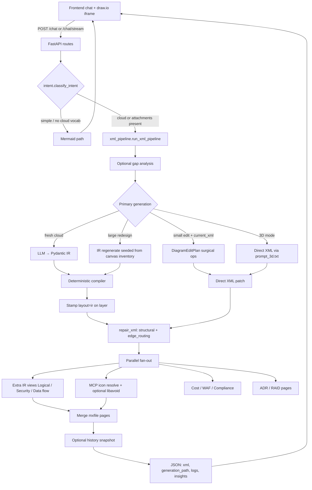
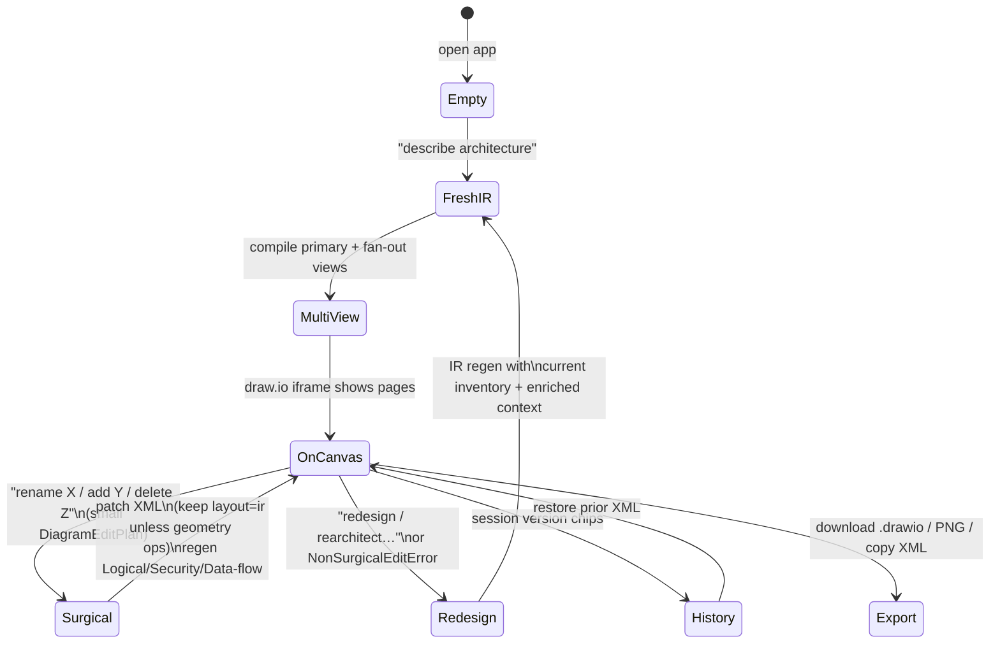

# Draw.io AI Architect

AI-powered cloud architecture diagrams. Describe infrastructure in natural language (AWS / GCP / Azure / multi-cloud) and get a live, editable draw.io diagram — with multi-view pages (Logical, Network, Security, Data flow), optional cost / Well-Architected / compliance insights, and surgical edit support.

FastAPI backend (`app/`) + vanilla HTML/JS frontend (`static/`) embedding a draw.io iframe.

## Run locally

1. Configure [`.env`](.env) — see **[docs/ENV_AND_MCP.md](docs/ENV_AND_MCP.md)** for every key.
2. Set at least one LLM API key (`ANTHROPIC_API_KEY` recommended for IR quality; `OPENAI_API_KEY` / `GOOGLE_API_KEY` also work).
3. Install and start:

```powershell
pip install -r requirements.txt
python run.py
```

Open `http://localhost:8000/`. Use **Render** for `Auto (MCP)` / `MCP` / `Local`.

```bash
pytest                              # full suite
pytest tests/test_ir_pipeline.py -q # focused
```

---

## Architecture overview

Hexagonal / ports-and-adapters layout:

```text
app/
  domain/
    entities/          # XmlDiagram, Mermaid — no I/O
    ir/                # NetworkIR + CorridorIR (Logical/Security/Data flow)
  core/services/       # agent.py, xml_pipeline.py, intent.py
  adapters/
    inbound/web/       # FastAPI routes, schemas, rate limits
    outbound/
      llm/             # providers.json registry, LangChain clients, fallback
      diagram/         # compile, repair, MCP icons, edge_routing
        compiler/      # IR → draw.io XML (geometry + styles)
        geometry_spec  # single source of spacing constants
        edge_routing   # exit/entry anchors + obstacle routes (not layout)
      utils/           # documents, web, chat
      cost / WAF / compliance / history_store / capture_store
static/                # chat UI + draw.io iframe
config/
  xml_gen/ir/          # IR prompt packs (judgment, not pixels)
  providers.json       # LLM provider registry
```

### Ownership split

| Piece | Owns | Does **not** own |
| --- | --- | --- |
| **LLM** | IR structure: nesting, flows, leaf `shape_type` keys | Pixel geometry, official icon stencils |
| **IR types** (`domain/ir/`) | Structural invariants (`semantic_errors`, nesting) | Rendering |
| **Compiler** | Geometry, styles, parent wiring, ELK corridor layout | Icon stencils |
| **Prompt packs** (`config/xml_gen/ir/`) | Classification / viewpoint judgment | Coordinates |
| **Draw.io MCP** | `search_shapes` → official leaf icons; optional libavoid | Nesting meaning |
| **`edge_routing`** | Edge exit/entry + local orthogonal detours | Moving boxes |
| **UI** | Chat, iframe, history restore, render mode | Generation logic |

---

## End-to-end request flow



Orchestrator: [`app/core/services/xml_pipeline.py`](app/core/services/xml_pipeline.py)  
IR prompts: [`config/xml_gen/ir/`](config/xml_gen/ir/)  
Env / MCP detail: [`docs/ENV_AND_MCP.md`](docs/ENV_AND_MCP.md)

### Response fields that matter

| Field | Meaning |
| --- | --- |
| `generation_path` | `ir` (compiled from validated IR) or `direct_xml` (surgical edit or 3D) |
| `renderer_used` | `mcp` or `local` — icon resolution only, not how structure was built |
| `degraded_features` | Soft-failed branches (view quality, quota, missing secondary tab) |
| `llm_usage` | Token/cost to *generate* the diagram (distinct from depicted cloud spend) |
| `logs` | Structured step log (also streamed as SSE on `/chat/stream`) |

---

## Diagram lifecycle (create → update → restore)



### Lifecycle stages in detail

**1. Fresh generation (IR path — default)**  
User prompt → optional gap analysis → LLM emits a view-specific IR (`NetworkIR` / `LogicalIR` / …) → Pydantic + `semantic_errors()` validate → compiler lays out XML (`geometry_spec` spacing; ELK for corridor views) → stamp `layout="ir"` → thin `repair_xml` (structure + `edge_routing`, **no** leaf resize / pitch nudges) → MCP merges official icons → optional libavoid → parallel extra views / ADR / RAID / cost / WAF.

**2. Surgical edit (keep most of the canvas)**  
When `current_xml` is present and the ask looks small, the agent returns a `DiagramEditPlan` (add/delete/move/connect/relabel). Relabel keeps `layout="ir"` so band alignment survives; geometry-changing ops clear it so fit logic can run. Extra IR view tabs regenerate so they stay aligned; ADR/RAID are skipped to save cost.

**3. Non-surgical redesign**  
If the plan is “too big” (`NonSurgicalEditError`), the pipeline regenerates via IR, seeded with an inventory of what’s already on the canvas plus the same enriched context the primary page saw — so Logical/Security/Data flow describe the *same* system.

**4. Multi-view quality**  
Secondary views score against viewpoint rules (`VIEW_QUALITY_MIN_SCORE`). Below the gate: one IR corrective retry, then keep the best attempt and mark `degraded_features` rather than failing the whole request.

**5. History / restore**  
Successful responses can be snapshotted (`DIAGRAM_HISTORY_*`). UI version chips call history APIs to restore prior XML without regenerating.

**6. Optional VLM QA**  
When `DIAGRAM_VLM_QA=true`, a fail-open visual checklist runs per page and may trigger one edge re-anchor via `edge_routing`.

---

## Generation paths at a glance

| Mode | When | Path | `generation_path` |
| --- | --- | --- | --- |
| Fresh cloud | Default multi-view | IR → compiler | `ir` |
| Surgical edit | Small change + `current_xml` | Direct XML ops | `direct_xml` |
| Redesign | Large edit / NonSurgical | IR regen | `ir` |
| 3D / isometric | `three_d=true` | Direct XML (`prompt_3d.txt`) | `direct_xml` |
| Simple / generic | No cloud vocabulary, no attachments | Mermaid | n/a |

`DIAGRAM_IR_ENABLED` / `DIAGRAM_IR_VIEWS` gate which views use IR. Fresh IR failure fails the request — there is no silent direct-XML fallback.

---

## API

| Endpoint | Purpose |
| --- | --- |
| `POST /chat` | Multi-turn diagram generation |
| `POST /chat/stream` | Same with SSE progress events |
| `POST /generate` | Single-turn generate |
| `POST /download` | Return `.drawio` XML attachment |
| `POST /parse-url` | Fetch URL text for context |
| `GET /health` | Health check |
| `GET /captures` | List saved request/response captures |
| `GET /history/sessions` | Diagram version sessions |
| `GET /history/versions/{id}` | Restore one version (full XML) |

---

## UI notes

- Toast notifications for errors / degraded features
- Insights tabs: Cost | WAF | Compliance | Logs
- Export: Download `.drawio`, PNG, Copy XML
- Session version chips restore prior successful XML
- Attachments: PDF / images (vision) and text/markdown/JSON/YAML (inlined context)
- Render select: Auto (MCP) / MCP / Local

---

## Related docs

| Doc | Contents |
| --- | --- |
| [docs/ENV_AND_MCP.md](docs/ENV_AND_MCP.md) | Env keys, MCP, IR flags, history, rate limits |
| [docs/CLOUD_DIAGRAM_SKILLS.md](docs/CLOUD_DIAGRAM_SKILLS.md) | Cursor skills for offline `.drawio` authoring |
| [CLAUDE.md](CLAUDE.md) | Contributor guidance for agents working in this repo |
| [config/providers.json](config/providers.json) | LLM provider registry |

Optional Cursor skills under [`.cursor/skills/`](.cursor/skills/) produce publish-quality diagrams inside Cursor chat; they are separate from the FastAPI runtime MCP (`DRAWIO_MCP_URL`).
