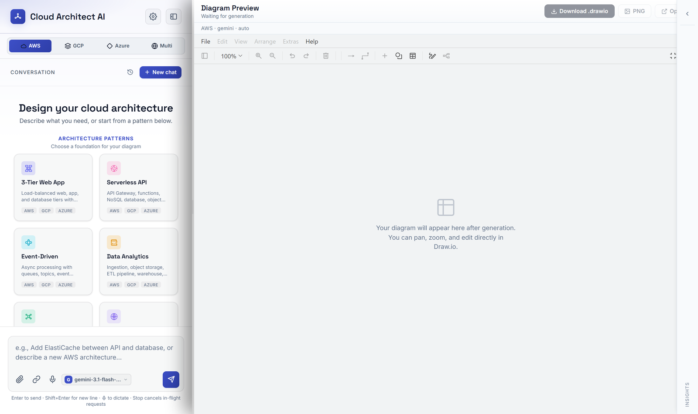
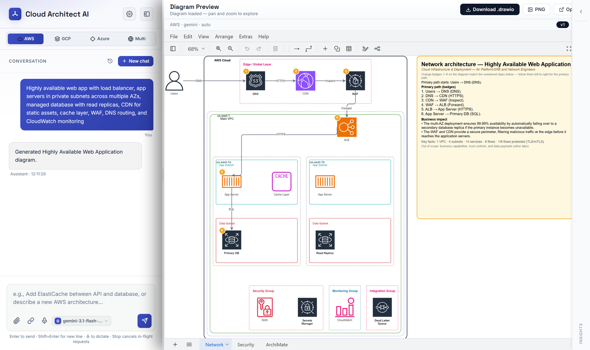
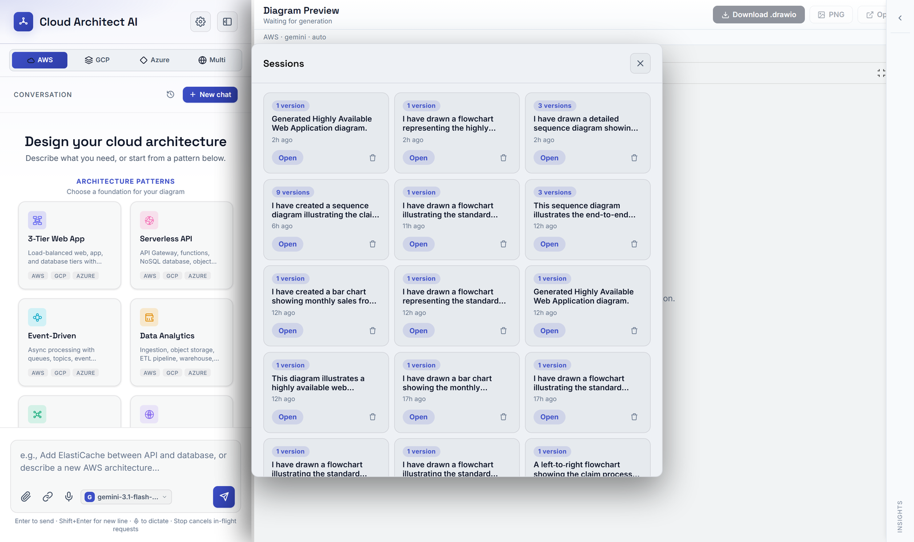
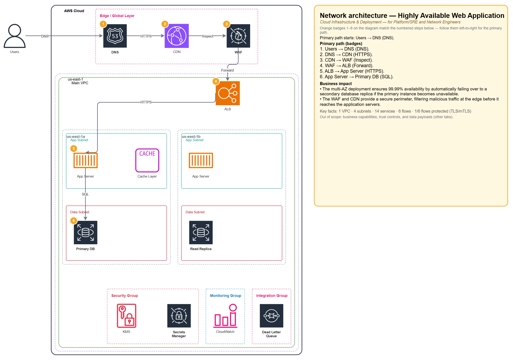
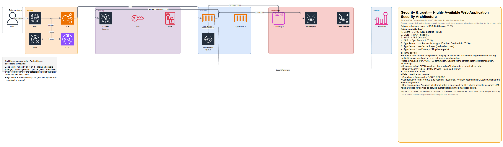
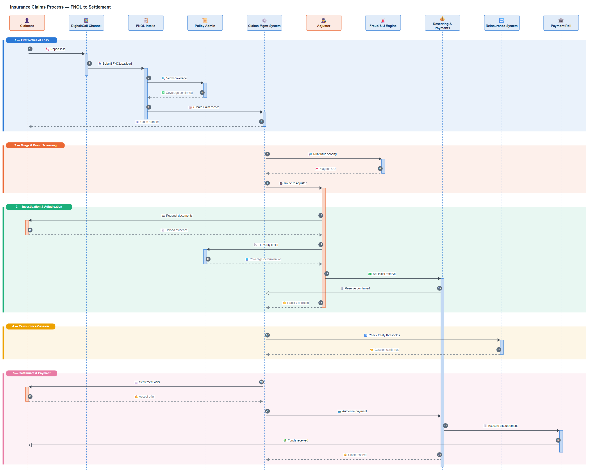
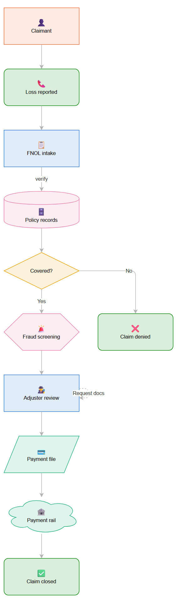
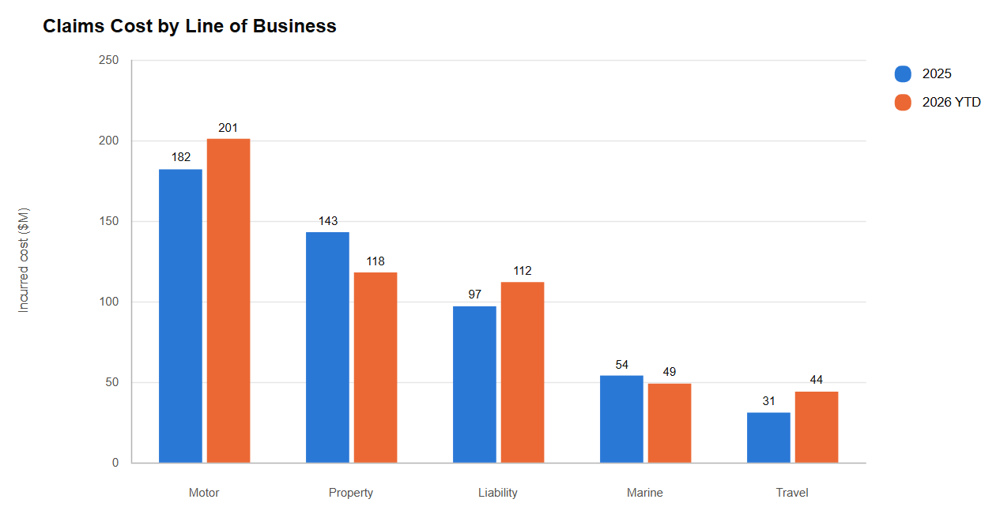
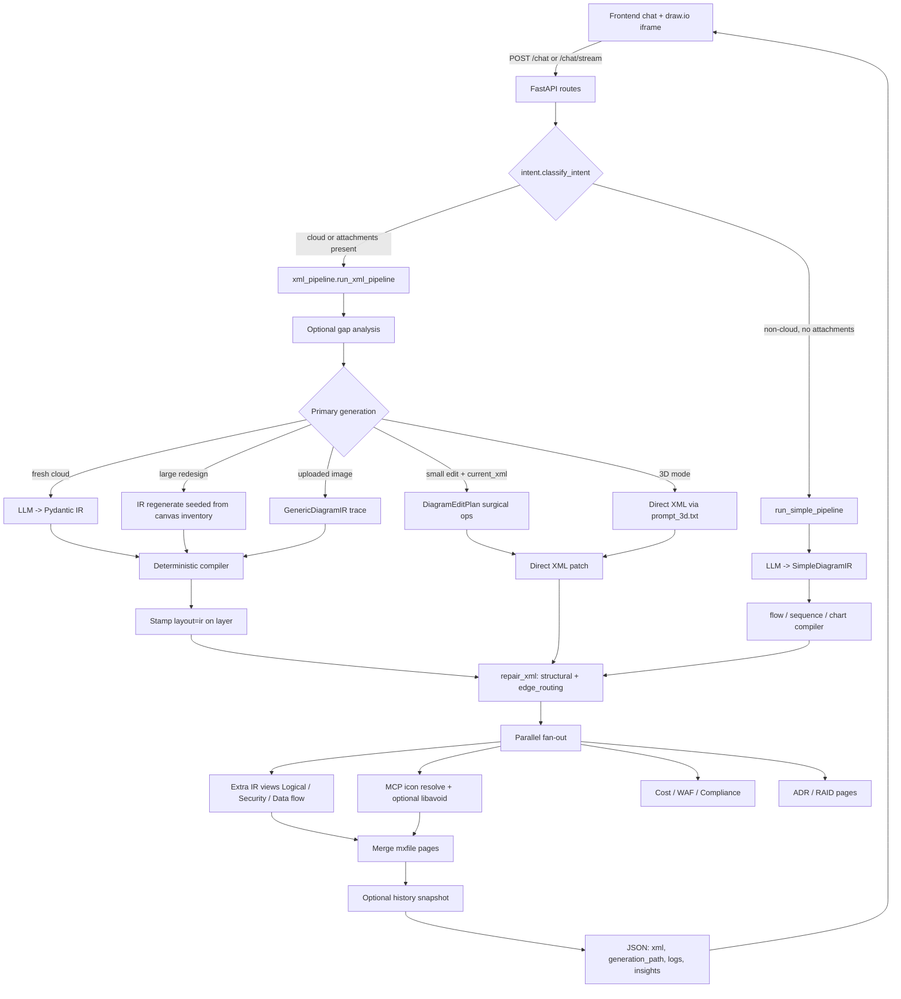
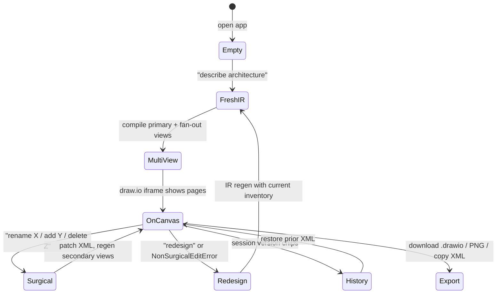

# Draw.io AI Architect

Describe a system in plain English; get back a **live, editable draw.io diagram** — not a
picture of one. Cloud architecture across AWS / GCP / Azure / multi-cloud, plus flowcharts,
sequence diagrams, org charts, state machines and data charts.

Every diagram lands in an embedded draw.io canvas you can drag, edit, extend and export as
`.drawio` / PNG / SVG / XML. Cloud requests additionally fan out into **multiple viewpoint pages**
(Network, Security, Logical, Data flow, ArchiMate) and optional cost, Well-Architected and
compliance insights.

FastAPI backend (`app/`) + vanilla HTML/JS frontend (`static/`) embedding a draw.io iframe.

**[What it's for](#what-its-for)** · **[The application](#the-application)** ·
**[Example output](#example-output)** · **[Run locally](#run-locally)** ·
**[What makes it different](#what-makes-it-different)** ·
**[Architecture](#architecture-overview)** · **[Runtime](#runtime-architecture)** ·
**[Controlling quality](#controlling-quality)** ·
**[API](#api)** · **[Known gaps](#known-gaps)**

---

## What it's for

| You need to… | Ask for | You get |
| --- | --- | --- |
| Design or document cloud infrastructure | *"Highly available web app: ALB, app servers in private subnets, multi-AZ RDS"* | Multi-AZ VPC with official cloud icons, numbered request path, plus Security / Logical / ArchiMate pages |
| Explain a system to a non-technical audience | *"…and show the business impact"* | An overview panel translating the topology into availability/risk language |
| Estimate before you build | any cloud prompt | Monthly cost breakdown, Well-Architected findings, compliance mapping |
| Document a process end-to-end | *"FNOL claims process, end to end, in detail"* | Sequence diagram with phase bands, activation bars and derived call/return pairing |
| Map a decision flow | *"draw the claim approval flow"* | Flowchart with decision branches, retry loops and datastores |
| Put numbers in front of people | *"claims cost by line of business"* | Bar / line / pie / gantt chart with a validated palette |
| Turn a whiteboard photo into an editable file | upload an image | A traced draw.io diagram that reproduces the layout you photographed |
| Modify what's on screen | *"rename checkout to orders"*, *"add a Redis cache"* | A surgical patch — the rest of the canvas is left exactly as it was |

Everything is driven from one chat box. Attachments (PDF / image / text) become context for
cloud designs; follow-up turns edit the diagram already on the canvas.

---

## The application

Chat on the left, a live draw.io editor on the right. Pick a cloud platform, start from an
architecture pattern or just describe what you want, and choose which model answers.



After a generation the diagram is in a real draw.io canvas — pan, zoom, drag boxes, edit
labels. Viewpoint pages appear as tabs along the bottom (**Network · Security · ArchiMate**),
the version chip (`v1`) tracks history, and the diagram exports as `.drawio`, PNG, SVG or raw
XML — the SVG carries its own XML, so it stays editable rather than becoming a picture.
Follow-up messages edit what's already on the canvas.



Every successful generation is snapshotted. Past sessions reopen with their full conversation
and diagram, and each session keeps its own version list.



---

## Example output

### Cloud architecture — multi-view, real icons

> *"Highly available web app with load balancer, app servers in private subnets, multi-AZ database"*



Official AWS stencils resolved through the draw.io MCP server, a numbered primary request
path, trust-coloured subnet tiers, and an overview panel carrying the business impact and key
facts. The same request produces a **Security & trust** page from the same model:



Trust zones ramp by sensitivity (public → DMZ → private → restricted), edge colour encodes
data classification, and the legend explains both — so a CISO and a network engineer can read
the same generation from their own viewpoint.

### Sequence diagram — process across many systems

> *"Insurance claims process, FNOL to settlement, end to end"*



Participant cards coloured by role (people vs systems), the emoji in each label lifted out as
its icon, phase bands with title tabs grouping the conversation into stages, and activation
bars **derived** from sync/reply pairing rather than declared. The vertical axis is time, so
nothing is allowed to reflow it.

### Flowchart

> *"draw the claim approval flow"*



Shapes carry meaning (decision, datastore, terminal, person) and colour is assigned by role
from one shared palette, so a flowchart, a sequence diagram and a chart from this app look
like one product.

### Charts

> *"claims cost by line of business, 2025 vs 2026"*



Bar / line / pie / gantt, plotted rather than laid out — direct value labels, a legend row,
and a categorical palette validated for colour-vision deficiency and contrast.

---

## Run locally

Two runtimes are required: **Python 3.11+** for the app and **Node 20+** for ELK layout. A
Python-only environment installs fine and then fails at request time on every corridor and
network view.

1. `cp .env.example .env`, then fill in at least one LLM API key (`ANTHROPIC_API_KEY`
   recommended for IR quality; `OPENAI_API_KEY` / `GOOGLE_API_KEY` also work). `.env` is
   gitignored — keep it that way. Every key is documented in
   **[docs/ENV_AND_MCP.md](docs/ENV_AND_MCP.md)**.
2. Install and start:

```powershell
pip install -r requirements.txt      # or requirements.lock for exact pins
python run.py
```

Open `http://localhost:8000/`. Use **Render** for `Auto (MCP)` / `MCP` / `Local`.

> Without an MCP server reachable, cloud diagrams still generate — leaves render as neutral
> placeholder boxes instead of official vendor icons. Structure, layout and every other view
> are unaffected.

### Working on it

```bash
pip install -r requirements-dev.txt

pytest                              # full suite (~1,496 tests, 92 files)
pytest tests/test_ir_pipeline.py -q # focused
ruff check .                        # lint
lint-imports                        # architecture boundaries
pytest --cov                        # suite + coverage floor

# Browser-driven, and the only automated coverage static/js has. Skips locally
# without a browser (`playwright install chromium`); CI sets REQUIRE_BROWSER_TESTS=1
# so the skip becomes a failure — a browser job that skips is a green check
# proving nothing.
pytest tests/test_voice_mode_browser.py tests/test_chat_flow_browser.py
```

All of the above run in CI on every push and pull request
([`.github/workflows/ci.yml`](.github/workflows/ci.yml)), which also builds the container and
boots it against `/health`.

One check cannot run in CI and has to be run deliberately. `data/` is gitignored in full, so
on a runner the replay net would find zero captures and exit 0 having verified nothing:

```bash
python tools/replay_captures.py --update-baseline   # once, BEFORE layout work
python tools/replay_captures.py --strict            # after
```

It replays every stored capture's IR through the current compiler. Record the baseline
*before* starting — doing it after bakes in whatever you just changed and the check can only
pass. `--strict` turns "no corpus" and "no baseline" into failures so a wiped `data/` cannot
imitate a pass.

### Dependencies

| File | Role |
| --- | --- |
| `requirements.txt` | What the app **declares** — open ranges |
| `requirements.lock` | What actually installs — exact pins, cross-platform |
| `requirements-dev.txt` / `.lock` | Test and lint tooling; never in the image |

The locks are generated with `uv pip compile --universal` so a file produced on Windows
installs on the Linux runner, and resolved against a constraints file from a verified
environment so they pin versions the suite has actually passed against. Regeneration commands
are in each lock's header.

### Container

```bash
docker build -t drawio-agent .
docker run -p 8000:8000 --env-file .env -v "$PWD/data:/app/data" drawio-agent
```

Serves uvicorn directly rather than `run.py` (which enables the reloader), runs as a non-root
user, and uses **one worker deliberately** — the LLM concurrency pool, the in-memory style
cache and the rate-limit counters are all per-process, so a second worker would silently
double the effective `MAX_CONCURRENT_LLM`. Scale with replicas, after moving the stores off
SQLite.

### Deploying (Render)

[`render.yaml`](render.yaml) is a Render Blueprint that builds and runs the same `Dockerfile`
— connect the repo as a Blueprint in the Render dashboard, then set the `sync: false` secrets
it lists (an LLM key, `CORS_ORIGINS`, `API_KEY`, …) in the service's Environment tab.

Every store here degrades to a no-op rather than crashing when it can't write, so the free
plan's ephemeral disk is fine to run on — history, templates and the icon-style cache just
reset on restart instead of the app failing.

`autoDeploy` is off. The only deploy trigger is the `deploy` job in
[`.github/workflows/ci.yml`](.github/workflows/ci.yml), which runs after `test` and `docker`
both pass on a push to `main` — Render's default is to deploy the instant it sees a push,
racing ahead of CI regardless of whether it's green. Wire it up once: Render service →
Settings → Deploy Hook → Create Deploy Hook → copy the URL → GitHub repo → Settings → Secrets
and variables → Actions → New repository secret → `RENDER_DEPLOY_HOOK_URL`. Until that secret
exists the step logs a warning and exits cleanly rather than failing CI.

Setting `API_KEY` gates every route except `/`, `/health` and `/static/*` —
`static/js/api-key.js` is what lets the browser itself satisfy that gate (prompts once, stores
the key in `localStorage`, retries transparently).

---

## What makes it different

**The LLM never writes coordinates.** It emits a validated intermediate representation (IR) —
structure only: what nests inside what, what talks to what, which service each leaf is. A
deterministic compiler owns every pixel. This is the central design decision and most of the
advantages below fall out of it:

| | Why it matters |
| --- | --- |
| **Layout is reproducible** | The same IR always compiles to the same geometry. Spacing lives in one file (`geometry_spec.py`) shared by the compiler *and* the diagnostics that check it. |
| **Failures are loud, not crooked** | A structurally invalid diagram fails `semantic_errors()` and gets one corrective pass. It cannot reach the canvas as overlapping boxes and dangling arrows. |
| **Icons are real** | Leaf stencils are resolved from the draw.io shape library via MCP, not invented by the model — so an S3 bucket looks like an S3 bucket. |
| **One system, many viewpoints** | Network, Security, Logical, Data-flow and ArchiMate pages are generated from the same design, so they describe the *same* architecture rather than five unrelated drawings. |
| **Edits are surgical** | A rename patches one cell and keeps `layout="ir"`, so band alignment survives. Only genuinely large changes regenerate. |
| **The output is a file, not an image** | Everything is mxGraph XML in an editable canvas. Nothing is a screenshot you have to redraw by hand to change. |
| **Nothing is silently truncated** | Diagram size is a note in the log, never a cap. Ask for fifty services and you get fifty. |
| **It tells you what it made up** | When a model returns components but no connections, the request path is synthesized so the page compiles at all. That page is named back to you rather than passed off as described. |
| **House rules are checkable** | Governance rules are deterministic structural checks, not "ask a model whether this looks compliant" — the same diagram always produces the same findings. |

---

## Architecture overview

Hexagonal / ports-and-adapters layout:

```text
app/
  domain/
    entities/          # XmlDiagram, DiagramEditPlan — no I/O
    ir/                # NetworkIR + CorridorIR (Logical/Security/Data flow),
                       # GenericDiagramIR (image tracing), SimpleDiagramIR (non-cloud)
  core/
    config.py          # one-time .env load + static paths (no snapshots)
    logging.py         # StepLogger: step entries, timings, rotating files
    ports/             # LlmPort — the core↔adapter boundary
    services/          # agent.py, xml_pipeline.py, intent.py, governance.py
  adapters/
    inbound/web/       # FastAPI routes, admin routes, schemas, rate limits
    outbound/
      config/          # env_config.py — the single config source
      llm/             # providers.json registry, LangChain clients, fallback
        concurrency.py # bounded private thread pool for provider calls
      diagram/         # compile, repair, MCP icons, edge_routing
        compiler/      # IR → draw.io XML (geometry + styles)
          chart.py     # plots bar/line/pie/gantt
          sequence.py  # lifelines, phase bands, derived activations
          simple.py    # dispatches the non-cloud kinds
          palette.py   # the one categorical palette every non-cloud view draws from
        geometry_spec  # single source of spacing constants
        edge_routing   # exit/entry anchors + obstacle routes (not layout)
        elk_bridge.py  # ELK layout: long-lived sidecar + per-call fallback
        view_conformance / simple_conformance  # scores a page against its viewpoint rules
      sqlite_util.py   # tuned connections (WAL + busy timeout) for every store
      utils/           # documents, web, chat
      cost / WAF / compliance / saas_catalog
      history_store / capture_store / template_store / governance_store /
      admin_settings_store   # every one degrades to a no-op rather than raising
static/                # chat UI + draw.io iframe
tools/elk_layout/      # layout.js (one-shot) + serve.js (sidecar), vendored elkjs
config/
  xml_gen/ir/          # IR prompt packs (judgment, not pixels)
  references/          # shape_type catalogs — IR-native, no stencil syntax
  providers.json       # LLM provider registry
```

### Ownership split

| Piece | Owns | Does **not** own |
| --- | --- | --- |
| **LLM** | IR structure: nesting, flows, leaf `shape_type` keys | Pixel geometry, official icon stencils |
| **IR types** (`domain/ir/`) | Structural invariants (`semantic_errors`, nesting) | Rendering |
| **Compiler** | Geometry, styles, parent wiring, ELK corridor layout | Icon stencils |
| **Prompt packs** (`config/xml_gen/ir/`) | Classification / viewpoint judgment | Coordinates |
| **Draw.io MCP** | `search_shapes` → official leaf icons; optional libavoid | Nesting meaning |
| **`edge_routing`** | Edge exit/entry + local orthogonal detours | Moving boxes |
| **UI** | Chat, iframe, history restore, render mode | Generation logic |

### Three IR families

| IR | Used for | Compiler |
| --- | --- | --- |
| `NetworkIR` / `CorridorIR` | Cloud architecture — the multi-view path | `compiler/network.py`, `compiler/corridor.py` (ELK) |
| `SimpleDiagramIR` | Non-cloud: `flow`, `sequence`, `bar`, `line`, `pie`, `gantt` | `compiler/simple.py` → generic / sequence / chart |
| `GenericDiagramIR` | Tracing an uploaded image as-is | `compiler/generic.py` |

`SimpleDiagramIR` is one discriminated schema so the non-cloud path stays a **single** LLM
call — the model picks the representation that fits the request without a separate
classification round-trip.

---

## Runtime architecture

The pieces below are invisible in a single request and decide how the app behaves under load,
on failure and on shutdown. Each carries a measurement or a failure mode that motivated it.

### ELK layout runs on a long-lived sidecar

Layout is computed by `elkjs` under Node. Starting Node and loading elkjs costs **~300–400 ms
regardless of graph size**, while the layout itself is 31 ms (6 nodes) to 101 ms (120 nodes) —
so spawning per call spent several times more starting the engine than using it, once per
view.

`tools/elk_layout/serve.js` now stays up and answers newline-delimited JSON requests in FIFO
order. Measured across 5 views of 40 nodes:

| strategy | wall clock |
| --- | --- |
| per-call cold spawns (concurrent) | 932 ms |
| **one sidecar, serialized** | **233 ms** |
| sidecar pool, 5 processes | 170 ms |

Serialized still wins fourfold, because concurrent process starts contend worse than linearly
— so this is one process, not a pool. A single-view request goes 385 ms → 46 ms. Replayed
against the 32 ELK graphs the compiler actually builds during the test suite: **12.4× faster,
byte-identical geometry on 32 of 32**.

Any failure — death, wedge, or a response-id mismatch — falls back to the per-call `layout.js`
spawn, so the fast path degrades to the one that always worked rather than failing a request.
A timeout or id mismatch *kills* the process instead of reusing it: the pipe's framing is no
longer trustworthy, and returning a late reply as the next request's response would be silent
layout corruption. `ELK_SIDECAR_ENABLED=false` forces the old path.

### LLM calls run on a bounded private pool

`MAX_CONCURRENT_LLM` is enforced by a dedicated `ThreadPoolExecutor`, never by a semaphore
around `asyncio.to_thread`. A semaphore guards the *coroutine*, not the thread — so when a
request hits `REQUEST_TIMEOUT_SECONDS` the coroutine is cancelled, the permit is released, and
the provider call keeps running uncounted. Measured at a cap of 2, four calls ran
simultaneously.

A pool worker stays occupied until the call genuinely finishes, so the cap holds under
cancellation; excess work queues as backpressure; and LLM calls never touch the default
executor that the ~40 store and document `to_thread` calls share. Cancelling before the work
is dequeued withdraws it outright, so a request that times out while queued never reaches the
provider.

The pipeline stays thread-offloaded rather than natively async on purpose: the functions
behind `run_llm_sync` interleave provider calls with CPU-bound IR compilation, ELK layout and
XML rewriting. Making them `async def` and awaiting only the LLM would move that CPU work onto
the event loop.

### SQLite stores are WAL, with a busy timeout

Every store is reached from threadpool workers, so two requests genuinely touch the same file
at once. `sqlite_util.connect()` applies WAL (readers never block on the writer), a 5 s busy
timeout (a contended writer waits instead of raising `database is locked`),
`synchronous=NORMAL` and `foreign_keys=ON`, degrading to defaults if the filesystem refuses.
Use it instead of `sqlite3.connect`.

### Config has exactly one source

`env_config.EnvConfigAdapter`, read via `get_config().<setting>` at the point of use. Never
capture a setting as an import-time constant: a snapshot taken before `init_config()` cannot
be refreshed in modules that already imported it. `core/config.py` owns only the one-time
`.env` + admin-override load and the static `BASE_DIR`/`STATIC_DIR` paths.

### Observability

`StepLogger` entries carry timestamps *and* durations. `logger.span(...)` (usable as `with` or
`async with`) records `duration_ms` per stage and accumulates a per-step total;
`_build_response` emits the breakdown as a final `step="timings"` entry, so every response
carries a stage profile through the existing `logs`/SSE/file-log paths. Every provider call is
timed inside `call_llm`, covering the corrective re-ask and each backoff retry rather than just
the first try.

### Shutdown

A FastAPI `lifespan` drains the LLM pool (letting in-flight calls finish) and then stops the
ELK sidecar — in that order, since layouts run on pool threads. It also warns once at startup
when the app is bound off-loopback with development defaults (CORS `*`, no API key, no rate
limit, a stock admin password).

---

## Quality gates

| Gate | Enforces |
| --- | --- |
| `ruff check .` | A narrow, high-signal ruleset — see the rationale in `pyproject.toml` |
| `lint-imports` | `domain` imports nothing outward; `core → adapters` is frozen at its current set |
| `pytest --cov` | ~1,496 tests plus a coverage floor |
| CI `frontend` job | Browser-driven tests — the only automated coverage `static/js` has |
| CI Docker job | The image builds and the container answers `/health` |
| `tools/replay_captures.py` | Layout/geometry regression against the stored corpus — local only, see [Working on it](#working-on-it) |

Three of these are ratchets rather than aspirations, and each exists because of a specific
failure. The `core → adapters` allowlist freezes 22 pre-existing violations so a **new** one
fails review — it is meant to shrink, never grow. The coverage floor sits just under current
coverage so it fails on regression; it is the one check that would have caught a merged commit
of ~6,000 lines that could not run, since lint and tests never execute unimported code. The
browser job sets `REQUIRE_BROWSER_TESTS=1`, turning the "no browser installed" skip into a
failure — the tests once skipped in CI for want of a locked `playwright`, so the job stayed
green while testing nothing. `tests/test_dependency_locks.py` now fails when a `.txt` declares
something its lock omits.

The prompt packs get the same treatment: `tests/test_prompt_assembly.py` asserts that no IR
prompt ever *presents* draw.io XML syntax (`resIcon=`, `mxgraph.`, `parent="1"`) while still
allowing a pack to *forbid* it, and budget-checks all nine IR assemblies. Prompt packs are
program logic with no other safety net.

---

## End-to-end request flow



**Every path returns draw.io XML.** The non-cloud path used to return Mermaid source for the
frontend to hand the embed as `{action: "import", format: "mermaid"}` — draw.io has no
`import` action, so it replied `{error: "unknownMessage"}` and drew nothing, for every simple
diagram this app ever produced. The embed accepts mxGraph XML and nothing else.

Orchestrator: [`app/core/services/xml_pipeline.py`](app/core/services/xml_pipeline.py)
IR prompts: [`config/xml_gen/ir/`](config/xml_gen/ir/)
Env / MCP detail: [`docs/ENV_AND_MCP.md`](docs/ENV_AND_MCP.md)

### Response fields that matter

| Field | Meaning |
| --- | --- |
| `generation_path` | `ir` \| `simple_ir` \| `generic_ir` (compiled from a validated IR) or `direct_xml` (surgical edit or 3D) |
| `renderer_used` | `mcp` or `local` — icon resolution only, not how structure was built |
| `degraded_features` | Soft-failed branches, carrying the **view key** of any page that failed so the UI can name the missing tab |
| `inferred_connections` | Pages whose arrows `flow_spine` synthesized because the model returned no flows |
| `llm_usage` | Token/cost to *generate* the diagram (distinct from depicted cloud spend) |
| `logs` | Structured step log (also streamed as SSE on `/chat/stream`) |

---

## Diagram lifecycle (create → update → restore)



**1. Fresh generation (IR path — default)**
Prompt → optional gap analysis → LLM emits a view-specific IR → Pydantic + `semantic_errors()`
validate → compiler lays out XML (`geometry_spec` spacing; ELK for corridor views) → stamp
`layout="ir"` → thin `repair_xml` (structure + `edge_routing`, **no** leaf resize / pitch
nudges) → MCP merges official icons → parallel extra views / ADR / RAID / cost / WAF.

**2. Surgical edit (keep most of the canvas)**
When `current_xml` is present and the ask looks small, the agent returns a `DiagramEditPlan`
(add/delete/move/connect/relabel). Relabel keeps `layout="ir"` so band alignment survives;
geometry-changing ops clear it so fit logic can run. Extra IR view tabs regenerate so they stay
aligned; ADR/RAID are skipped to save cost.

**3. Non-surgical redesign**
If the plan is "too big" (`NonSurgicalEditError`), the pipeline regenerates via IR, seeded with
an inventory of what's already on the canvas plus the same enriched context the primary page
saw — so Logical/Security/Data flow describe the *same* system.

**4. Non-cloud follow-ups always regenerate**
A chart's geometry is *derived* from its data (a bar's height is its value), so patching cells
would relabel a bar without re-plotting it. Simple diagrams re-emit the whole IR, with the
current label inventory fed back in so anything you didn't ask to change survives.

**5. Multi-view quality**
Every page — primary included — scores against viewpoint rules (`VIEW_QUALITY_MIN_SCORE`).
Below the gate: one IR corrective retry by default, or the full
[validation loop](#the-validation-loop) when it is enabled. Then keep the best attempt and
mark `degraded_features` rather than failing the whole request — and the missing page is named
back to the user by *page*, not by internal branch.

**6. History / restore**
Successful responses can be snapshotted (`DIAGRAM_HISTORY_*`). UI version chips call history
APIs to restore prior XML without regenerating.

---

## Generation paths at a glance

| Mode | When | Path | `generation_path` |
| --- | --- | --- | --- |
| Fresh cloud | Default multi-view | IR → compiler | `ir` |
| Non-cloud | Flowchart, sequence, chart, org chart, ER, mindmap | `SimpleDiagramIR` → compiler | `simple_ir` |
| Image trace | An image was uploaded in as-is mode | `GenericDiagramIR` → compiler | `generic_ir` |
| Surgical edit | Small change + `current_xml` | Direct XML ops | `direct_xml` |
| Redesign | Large edit / NonSurgical | IR regen | `ir` |
| 3D / isometric | `three_d=true` | Direct XML (`prompt_3d.txt`) | `direct_xml` |

`DIAGRAM_IR_ENABLED` / `DIAGRAM_IR_VIEWS` gate which views use IR. Fresh IR failure fails the
request — there is no silent direct-XML fallback.

---

## Controlling quality

Four mechanisms check a generated diagram, and they are deliberately not interchangeable —
the cheapest one that can do the job is the right one.

| Check | Kind | On failure |
| --- | --- | --- |
| `semantic_errors()` | Hard structural rules on the IR | One corrective re-ask, then the request fails — no direct-XML fallback |
| `semantic_warnings()` | Soft IR-quality signals | One best-effort correction pass, never blocking |
| **Governance rules** | Your org's house style | Same single correction pass; reported on the Governance panel |
| **Validation loop** | Viewpoint conformance score | Regenerates the view while the score keeps improving |

### Governance rules

House-style policy, authored in the admin panel and checked against every generated
diagram — *"the ledger lives in the restricted zone"*, *"nothing in the public zone talks
straight to data"*, *"every design states its tradeoffs"*.

Every rule kind is a bounded structural fact-check over the IR: a corridor present, a field
non-empty, a flow's protection level, a leaf's placement, a forbidden direct flow. **No LLM
decides pass or fail**, so the same diagram always produces the same findings. That
reproducibility is the whole point — a conformance report a reviewer cannot trust to be
repeatable is worth less than no report at all. v1 is soft-only: a finding nudges the next
correction pass and appears on the panel; it never blocks a request, so a malformed rule
costs one un-nudged diagram rather than breaking generation org-wide.

### The validation loop

Off by default, because each iteration is a full view regeneration. When on, every page —
the primary one included — is scored against its viewpoint rules and regenerated **only
while it keeps measurably improving**.

| Setting | Meaning |
| --- | --- |
| `DIAGRAM_VALIDATION_ENABLED` | Turns the loop on (default off) |
| `DIAGRAM_VALIDATION_MAX_ITERATIONS` | Corrective passes on top of the first generation |
| `DIAGRAM_VALIDATION_MIN_IMPROVEMENT` | `0` = "any measurable gain"; a positive value says *don't spend another call on a two-point win* |
| `DIAGRAM_VALIDATION_PROVIDER` | Judge with a different model than the one that drew it; accepts `provider::model` |

Stopping on *improvement* rather than on a budget is the point of the setting: iterating
because a budget allows it, rather than because the diagram is getting better, is how a
pipeline burns tokens producing no change. On an exact score tie the tidier candidate wins
(fewer edge crossings) — both already exist and are already compiled, and the score cannot
separate them. Crossings are kept strictly as a tiebreak and out of the score itself: the
score judges what the model produced, crossings judge what the compiler drew from it.

A surgical edit and a 3D page are never regenerated to chase a score — that would throw away
the canvas you have been editing, which is worse than a view scoring 68.

### Admin panel

`/admin` (password-gated) manages provider credentials and the default model, the validation
settings above, and governance-rule authoring. Users can also bring their own key from the
composer without touching server config.

### Architecture interview

Optional. When the brief is thin, the app can answer with a short question set instead of
guessing — at most one follow-up round, because a user who has answered twice has earned
their diagram.

---

## API

| Endpoint | Purpose |
| --- | --- |
| `POST /chat` | Multi-turn diagram generation |
| `POST /chat/stream` | Same with SSE progress events |
| `POST /generate` | Single-turn generate |
| `POST /analyze` | Analyze an existing diagram |
| `POST /download` | Return `.drawio` XML attachment |
| `POST /attachments/extract` | Classify and extract an upload (never raises — errors come back as results) |
| `POST /parse-url` | Fetch URL text for context |
| `POST /diagram/validate-visual` | Screenshot-based vision QA, client-triggered after a diagram loads |
| `GET /providers`, `POST /providers/validate` | Provider catalog and key validation |
| `GET /health`, `GET /ready` | Liveness and readiness |
| `GET /captures`, `GET /captures/{id}` | Saved request/response captures |
| `GET /history/sessions` | Diagram version sessions |
| `GET /history/versions/{id}` | Restore one version (full XML) |
| `DELETE /history/sessions/{id}` | Delete a session |
| `GET/POST/PATCH/DELETE /templates…` | Saved prompt templates |
| `/admin/*` | Password-gated: providers, default model, validation settings, governance rules |

`POST /diagram/validate-visual` is distinct from the always-on `DIAGRAM_VLM_QA` geometry
linter — that one runs inside the pipeline and fails open; this one renders what is actually
on screen and is opt-in.

---

## UI notes

- Insights tabs: **Cost | Well-Architected & compliance | Governance | Suggestions | Logs**
- Export: `.drawio`, PNG, **SVG** (with its XML embedded, so it stays editable), Copy XML
- Session version chips restore prior successful XML
- Attachments: PDF / images (vision) and text/markdown/JSON/YAML (inlined context)
- Render select: Auto (MCP) / MCP / Local
- Voice mode: a conversational loop (~1.2 s of silence ends a turn, barge-in interrupts
  playback), routed entirely on the client in 0.2–1.2 ms. Dictation survives behind a toggle.
- Toasts **queue** rather than overwrite. There used to be one toast element, so whichever
  message wrote last won — a mid-turn warning was erased by the "Done" that followed it, every
  time. Warnings now jump ahead of routine news, repeats are suppressed, and a missing page is
  named ("The Logical page is missing from this diagram") instead of the branch that failed
  to produce it.

---

## Known gaps

Honest list of what is weak, in the order I'd fix it. Several are deliberate scope decisions
rather than bugs — those are marked.

### Diagram quality

- **Edge crossings are measured but not designed away.** 72% of Security pages exceed the
  crossing threshold (mean 5.3, worst 51; only 4 of 87 clean). Crossings currently break a
  scoring tie in the validation loop and nothing more. The layout pass meant to reduce them,
  `_reorder_row_leaves`, measurably *increases* them on 10 Logical pages against 9 improved
  (129 → 146 total). Fixing it needs a metric read from the compiled geometry, which is a
  separate piece of work.
- **Half the stored corpus needs a deterministic repair pass.** Models keep misplacing
  CloudFront / WAF / Route 53 / NAT despite the prompt packs naming them in four places. This
  is a model-compliance metric rather than a defect, and more prose is the approach that has
  repeatedly failed.
- **Very large pages crowd their edge labels.** Nothing is capped any more (by design), but at
  ~24 leaves on a Logical page the labels of adjacent flows start overlapping. The layout is
  correct; the labelling needs collision avoidance.
- **Charts are capped at 6 series / 6 pie slices.** Deliberate: the categorical palette is
  assigned in fixed slot order and never cycles, so a 7th could only reuse a colour already in
  use. Raising it means adding validated hues first.
- **Heatmap, Venn, wireframe and similar are not supported.** Deliberate — the model says so
  in its reply rather than substituting a confident lookalike.

### Operational

- **Single worker only.** The LLM concurrency pool, style cache and rate-limit counters are
  per-process. Horizontal scaling needs the stores moved off SQLite first.
- **Icons depend on an MCP server.** In `local` mode leaves are neutral placeholders. Nothing
  breaks, but a cloud diagram loses much of its value.
- **Auth is a single shared `API_KEY`.** There is no per-user identity, tenancy or
  authorization model.
- **Voice input depends on the browser's speech service.** Chrome/Edge stream audio to a
  remote recogniser; a blocked endpoint or a Chromium build without Google API keys produces a
  `network` error every time, with no server-side fallback.

### Codebase

- **22 frozen `core → adapters` import violations.** `lint-imports` stops new ones; the
  existing list is meant to shrink and hasn't yet.
- **`flow_spine` synthesis is a heuristic.** When a model returns no flows at all, the request
  path is invented in code — about one page in eleven (34 of 383 stored views). It connects
  every leaf, but the ordering it implies is a guess. It is at least no longer *silent*: the
  response carries `inferred_connections` and the UI names the affected page.

---

## Related docs

| Doc | Contents |
| --- | --- |
| [docs/ENV_AND_MCP.md](docs/ENV_AND_MCP.md) | Env keys, MCP, IR flags, history, rate limits |
| [docs/CLOUD_DIAGRAM_SKILLS.md](docs/CLOUD_DIAGRAM_SKILLS.md) | Cursor skills for offline `.drawio` authoring |
| [CLAUDE.md](CLAUDE.md) | Contributor guidance for agents working in this repo |
| [docs/PROMPT_BATTLE_TEST.md](docs/PROMPT_BATTLE_TEST.md) | Prompt-surface audit — open findings and their remediation order |
| [docs/COMPREHENSIVE_ARCHITECTURE_REVIEW.md](docs/COMPREHENSIVE_ARCHITECTURE_REVIEW.md) | Architecture audit. **Read the outcome table at the top first** — parts of the roadmap below it were implemented and reverted |
| [config/providers.json](config/providers.json) | LLM provider registry |

Optional Cursor skills under [`.cursor/skills/`](.cursor/skills/) produce publish-quality
diagrams inside Cursor chat; they are separate from the FastAPI runtime MCP
(`DRAWIO_MCP_URL`).

## License

[MIT](LICENSE). API keys and `ADMIN_PASSWORD` belong in a local `.env` copied from
[`.env.example`](.env.example). That file is gitignored and must stay that way.
