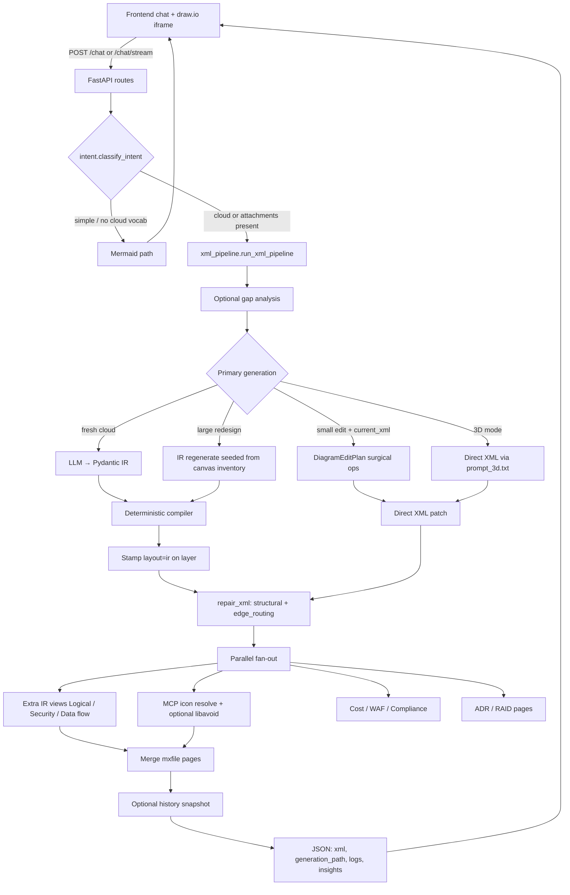
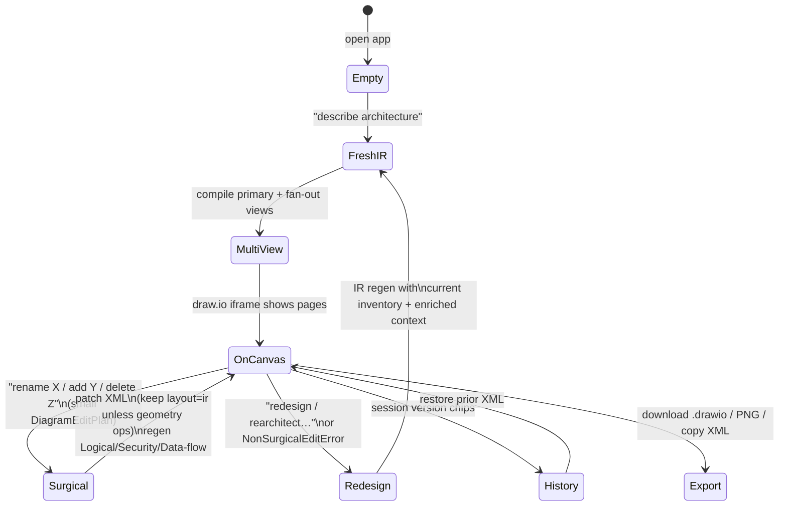

# Draw.io AI Architect

AI-powered cloud architecture diagrams. Describe infrastructure in natural language (AWS / GCP / Azure / multi-cloud) and get a live, editable draw.io diagram — with multi-view pages (Logical, Network, Security, Data flow), optional cost / Well-Architected / compliance insights, and surgical edit support.

FastAPI backend (`app/`) + vanilla HTML/JS frontend (`static/`) embedding a draw.io iframe.

## Run locally

Two runtimes are required: **Python 3.11+** for the app and **Node 20+** for
ELK layout. A Python-only environment installs fine and then fails at request
time on every corridor and network view.

1. `cp .env.example .env`, then fill in at least one LLM API key
   (`ANTHROPIC_API_KEY` recommended for IR quality; `OPENAI_API_KEY` /
   `GOOGLE_API_KEY` also work). `.env` is gitignored — keep it that way.
   Every key is documented in **[docs/ENV_AND_MCP.md](docs/ENV_AND_MCP.md)**.
2. Install and start:

```powershell
pip install -r requirements.txt      # or requirements.lock for exact pins
python run.py
```

Open `http://localhost:8000/`. Use **Render** for `Auto (MCP)` / `MCP` / `Local`.

### Working on it

```bash
pip install -r requirements-dev.txt

pytest                              # full suite (~1,165 tests, 81 files)
pytest tests/test_ir_pipeline.py -q # focused
ruff check .                        # lint
lint-imports                        # architecture boundaries
pytest --cov                        # suite + coverage floor
```

All four run in CI on every push and pull request
([`.github/workflows/ci.yml`](.github/workflows/ci.yml)), which also builds the
container and boots it against `/health`.

### Dependencies

| File | Role |
| --- | --- |
| `requirements.txt` | What the app **declares** — open ranges |
| `requirements.lock` | What actually installs — exact pins, cross-platform |
| `requirements-dev.txt` / `.lock` | Test and lint tooling; never in the image |

The locks are generated with `uv pip compile --universal` so a file produced on
Windows installs on the Linux runner, and resolved against a constraints file
from a verified environment so they pin versions the suite has actually passed
against. Regeneration commands are in each lock's header.

### Container

```bash
docker build -t drawio-agent .
docker run -p 8000:8000 --env-file .env -v "$PWD/data:/app/data" drawio-agent
```

Serves uvicorn directly rather than `run.py` (which enables the reloader), runs
as a non-root user, and uses **one worker deliberately** — the LLM concurrency
pool, the in-memory style cache and the rate-limit counters are all
per-process, so a second worker would silently double the effective
`MAX_CONCURRENT_LLM`. Scale with replicas, after moving the stores off SQLite.

---

## Architecture overview

Hexagonal / ports-and-adapters layout:

```text
app/
  domain/
    entities/          # XmlDiagram, Mermaid — no I/O
    ir/                # NetworkIR + CorridorIR (Logical/Security/Data flow)
  core/
    config.py          # one-time .env load + static paths (no snapshots)
    logging.py         # StepLogger: step entries, timings, rotating files
    ports/             # LlmPort — the core↔adapter boundary
    services/          # agent.py, xml_pipeline.py, intent.py
  adapters/
    inbound/web/       # FastAPI routes, schemas, rate limits
    outbound/
      config/          # env_config.py — the single config source
      llm/             # providers.json registry, LangChain clients, fallback
        concurrency.py # bounded private thread pool for provider calls
      diagram/         # compile, repair, MCP icons, edge_routing
        compiler/      # IR → draw.io XML (geometry + styles)
        geometry_spec  # single source of spacing constants
        edge_routing   # exit/entry anchors + obstacle routes (not layout)
        elk_bridge.py  # ELK layout: long-lived sidecar + per-call fallback
      sqlite_util.py   # tuned connections (WAL + busy timeout) for every store
      utils/           # documents, web, chat
      cost / WAF / compliance / history_store / capture_store
static/                # chat UI + draw.io iframe
tools/elk_layout/      # layout.js (one-shot) + serve.js (sidecar), vendored elkjs
config/
  xml_gen/ir/          # IR prompt packs (judgment, not pixels)
  references/          # shape_type catalogs — IR-native, no stencil syntax
  providers.json       # LLM provider registry
```

### Ownership split

| Piece | Owns | Does **not** own |
| --- | --- | --- |
| **LLM** | IR structure: nesting, flows, leaf `shape_type` keys | Pixel geometry, official icon stencils |
| **IR types** (`domain/ir/`) | Structural invariants (`semantic_errors`, nesting) | Rendering |
| **Compiler** | Geometry, styles, parent wiring, ELK corridor layout | Icon stencils |
| **Prompt packs** (`config/xml_gen/ir/`) | Classification / viewpoint judgment | Coordinates |
| **Draw.io MCP** | `search_shapes` → official leaf icons; optional libavoid | Nesting meaning |
| **`edge_routing`** | Edge exit/entry + local orthogonal detours | Moving boxes |
| **UI** | Chat, iframe, history restore, render mode | Generation logic |

---

## Runtime architecture

The pieces below are invisible in a single request and decide how the app
behaves under load, on failure and on shutdown. Each carries a measurement or a
failure mode that motivated it.

### ELK layout runs on a long-lived sidecar

Layout is computed by `elkjs` under Node. Starting Node and loading elkjs costs
**~300–400 ms regardless of graph size**, while the layout itself is 31 ms
(6 nodes) to 101 ms (120 nodes) — so spawning per call spent several times more
starting the engine than using it, once per view.

`tools/elk_layout/serve.js` now stays up and answers newline-delimited JSON
requests in FIFO order. Measured across 5 views of 40 nodes:

| strategy | wall clock |
| --- | --- |
| per-call cold spawns (concurrent) | 932 ms |
| **one sidecar, serialized** | **233 ms** |
| sidecar pool, 5 processes | 170 ms |

Serialized still wins fourfold, because concurrent process starts contend worse
than linearly — so this is one process, not a pool. A single-view request goes
385 ms → 46 ms. Replayed against the 32 ELK graphs the compiler actually builds
during the test suite: **12.4× faster, byte-identical geometry on 32 of 32**.

Any failure — death, wedge, or a response-id mismatch — falls back to the
per-call `layout.js` spawn, so the fast path degrades to the one that always
worked rather than failing a request. A timeout or id mismatch *kills* the
process instead of reusing it: the pipe's framing is no longer trustworthy, and
returning a late reply as the next request's response would be silent layout
corruption. `ELK_SIDECAR_ENABLED=false` forces the old path.

### LLM calls run on a bounded private pool

`MAX_CONCURRENT_LLM` is enforced by a dedicated `ThreadPoolExecutor`, never by a
semaphore around `asyncio.to_thread`. A semaphore guards the *coroutine*, not
the thread — so when a request hits `REQUEST_TIMEOUT_SECONDS` the coroutine is
cancelled, the permit is released, and the provider call keeps running
uncounted. Measured at a cap of 2, four calls ran simultaneously.

A pool worker stays occupied until the call genuinely finishes, so the cap holds
under cancellation; excess work queues as backpressure; and LLM calls never
touch the default executor that the ~40 store and document `to_thread` calls
share. Cancelling before the work is dequeued withdraws it outright, so a
request that times out while queued never reaches the provider.

The pipeline stays thread-offloaded rather than natively async on purpose: the
functions behind `run_llm_sync` interleave provider calls with CPU-bound IR
compilation, ELK layout and XML rewriting. Making them `async def` and awaiting
only the LLM would move that CPU work onto the event loop.

### SQLite stores are WAL, with a busy timeout

Every store is reached from threadpool workers, so two requests genuinely touch
the same file at once. `sqlite_util.connect()` applies WAL (readers never block
on the writer), a 5 s busy timeout (a contended writer waits instead of raising
`database is locked`), `synchronous=NORMAL` and `foreign_keys=ON`, degrading to
defaults if the filesystem refuses. Use it instead of `sqlite3.connect`.

### Config has exactly one source

`env_config.EnvConfigAdapter`, read via `get_config().<setting>` at the point of
use. Never capture a setting as an import-time constant: a snapshot taken before
`init_config()` cannot be refreshed in modules that already imported it.
`core/config.py` owns only the one-time `.env` + admin-override load and the
static `BASE_DIR`/`STATIC_DIR` paths.

### Observability

`StepLogger` entries carry timestamps *and* durations. `logger.span(...)` (usable
as `with` or `async with`) records `duration_ms` per stage and accumulates a
per-step total; `_build_response` emits the breakdown as a final
`step="timings"` entry, so every response carries a stage profile through the
existing `logs`/SSE/file-log paths. Every provider call is timed inside
`call_llm`, covering the corrective re-ask and each backoff retry rather than
just the first try.

### Shutdown

A FastAPI `lifespan` drains the LLM pool (letting in-flight calls finish) and
then stops the ELK sidecar — in that order, since layouts run on pool threads.
It also warns once at startup when the app is bound off-loopback with
development defaults (CORS `*`, no API key, no rate limit, a stock admin
password).

---

## Quality gates

| Gate | Enforces |
| --- | --- |
| `ruff check .` | A narrow, high-signal ruleset — see the rationale in `pyproject.toml` |
| `lint-imports` | `domain` imports nothing outward; `core → adapters` is frozen at its current set |
| `pytest --cov` | ~1,165 tests plus a coverage floor |
| CI Docker job | The image builds and the container answers `/health` |

Two of these are ratchets rather than aspirations, and both exist because of a
specific failure. The `core → adapters` allowlist freezes 24 pre-existing
violations so a **new** one fails review — it is meant to shrink, never grow.
The coverage floor sits just under current coverage so it fails on regression;
it is the one check that would have caught a merged commit of ~6,000 lines that
could not run, since lint and tests never execute unimported code.

The prompt packs get the same treatment: `tests/test_prompt_assembly.py`
asserts that no IR prompt ever *presents* draw.io XML syntax (`resIcon=`,
`mxgraph.`, `parent="1"`) while still allowing a pack to *forbid* it, and
budget-checks all nine IR assemblies. Prompt packs are program logic with no
other safety net.

---

## End-to-end request flow



Orchestrator: [`app/core/services/xml_pipeline.py`](app/core/services/xml_pipeline.py)  
IR prompts: [`config/xml_gen/ir/`](config/xml_gen/ir/)  
Env / MCP detail: [`docs/ENV_AND_MCP.md`](docs/ENV_AND_MCP.md)

### Response fields that matter

| Field | Meaning |
| --- | --- |
| `generation_path` | `ir` (compiled from validated IR) or `direct_xml` (surgical edit or 3D) |
| `renderer_used` | `mcp` or `local` — icon resolution only, not how structure was built |
| `degraded_features` | Soft-failed branches (view quality, quota, missing secondary tab) |
| `llm_usage` | Token/cost to *generate* the diagram (distinct from depicted cloud spend) |
| `logs` | Structured step log (also streamed as SSE on `/chat/stream`) |

---

## Diagram lifecycle (create → update → restore)



### Lifecycle stages in detail

**1. Fresh generation (IR path — default)**  
User prompt → optional gap analysis → LLM emits a view-specific IR (`NetworkIR` / `LogicalIR` / …) → Pydantic + `semantic_errors()` validate → compiler lays out XML (`geometry_spec` spacing; ELK for corridor views) → stamp `layout="ir"` → thin `repair_xml` (structure + `edge_routing`, **no** leaf resize / pitch nudges) → MCP merges official icons → optional libavoid → parallel extra views / ADR / RAID / cost / WAF.

**2. Surgical edit (keep most of the canvas)**  
When `current_xml` is present and the ask looks small, the agent returns a `DiagramEditPlan` (add/delete/move/connect/relabel). Relabel keeps `layout="ir"` so band alignment survives; geometry-changing ops clear it so fit logic can run. Extra IR view tabs regenerate so they stay aligned; ADR/RAID are skipped to save cost.

**3. Non-surgical redesign**  
If the plan is “too big” (`NonSurgicalEditError`), the pipeline regenerates via IR, seeded with an inventory of what’s already on the canvas plus the same enriched context the primary page saw — so Logical/Security/Data flow describe the *same* system.

**4. Multi-view quality**  
Secondary views score against viewpoint rules (`VIEW_QUALITY_MIN_SCORE`). Below the gate: one IR corrective retry, then keep the best attempt and mark `degraded_features` rather than failing the whole request.

**5. History / restore**  
Successful responses can be snapshotted (`DIAGRAM_HISTORY_*`). UI version chips call history APIs to restore prior XML without regenerating.

**6. Optional VLM QA**  
When `DIAGRAM_VLM_QA=true`, a fail-open visual checklist runs per page and may trigger one edge re-anchor via `edge_routing`.

---

## Generation paths at a glance

| Mode | When | Path | `generation_path` |
| --- | --- | --- | --- |
| Fresh cloud | Default multi-view | IR → compiler | `ir` |
| Surgical edit | Small change + `current_xml` | Direct XML ops | `direct_xml` |
| Redesign | Large edit / NonSurgical | IR regen | `ir` |
| 3D / isometric | `three_d=true` | Direct XML (`prompt_3d.txt`) | `direct_xml` |
| Simple / generic | No cloud vocabulary, no attachments | Mermaid | n/a |

`DIAGRAM_IR_ENABLED` / `DIAGRAM_IR_VIEWS` gate which views use IR. Fresh IR failure fails the request — there is no silent direct-XML fallback.

---

## API

| Endpoint | Purpose |
| --- | --- |
| `POST /chat` | Multi-turn diagram generation |
| `POST /chat/stream` | Same with SSE progress events |
| `POST /generate` | Single-turn generate |
| `POST /download` | Return `.drawio` XML attachment |
| `POST /parse-url` | Fetch URL text for context |
| `GET /health` | Health check |
| `GET /captures` | List saved request/response captures |
| `GET /history/sessions` | Diagram version sessions |
| `GET /history/versions/{id}` | Restore one version (full XML) |

---

## UI notes

- Toast notifications for errors / degraded features
- Insights tabs: Cost | WAF | Compliance | Logs
- Export: Download `.drawio`, PNG, Copy XML
- Session version chips restore prior successful XML
- Attachments: PDF / images (vision) and text/markdown/JSON/YAML (inlined context)
- Render select: Auto (MCP) / MCP / Local

---

## Related docs

| Doc | Contents |
| --- | --- |
| [docs/ENV_AND_MCP.md](docs/ENV_AND_MCP.md) | Env keys, MCP, IR flags, history, rate limits |
| [docs/CLOUD_DIAGRAM_SKILLS.md](docs/CLOUD_DIAGRAM_SKILLS.md) | Cursor skills for offline `.drawio` authoring |
| [CLAUDE.md](CLAUDE.md) | Contributor guidance for agents working in this repo |
| [docs/PROMPT_BATTLE_TEST.md](docs/PROMPT_BATTLE_TEST.md) | Prompt-surface audit — open findings and their remediation order |
| [docs/COMPREHENSIVE_ARCHITECTURE_REVIEW.md](docs/COMPREHENSIVE_ARCHITECTURE_REVIEW.md) | Architecture audit. **Read the outcome table at the top first** — parts of the roadmap below it were implemented and reverted |
| [config/providers.json](config/providers.json) | LLM provider registry |

Optional Cursor skills under [`.cursor/skills/`](.cursor/skills/) produce publish-quality diagrams inside Cursor chat; they are separate from the FastAPI runtime MCP (`DRAWIO_MCP_URL`).
